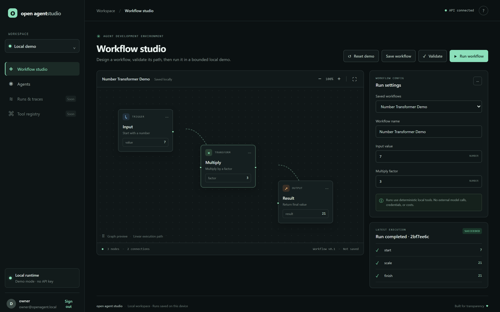
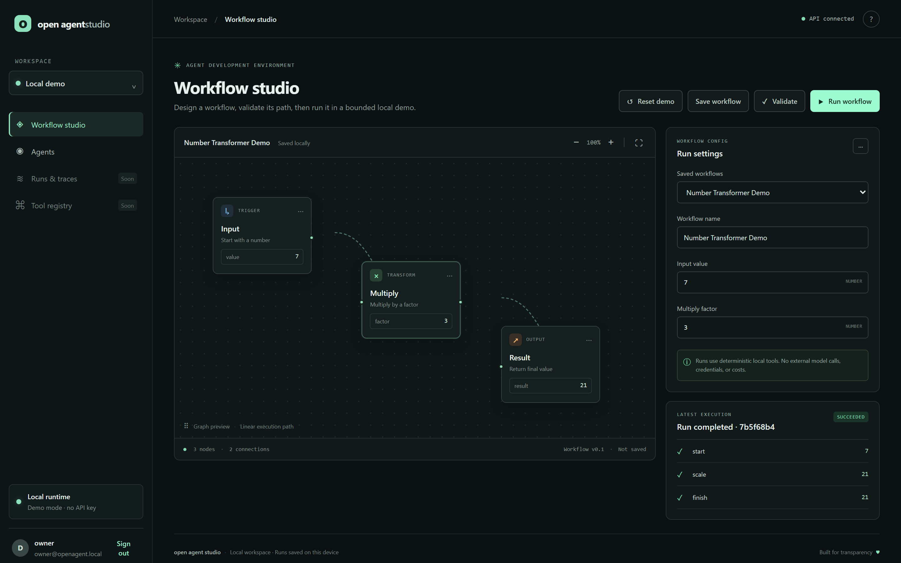
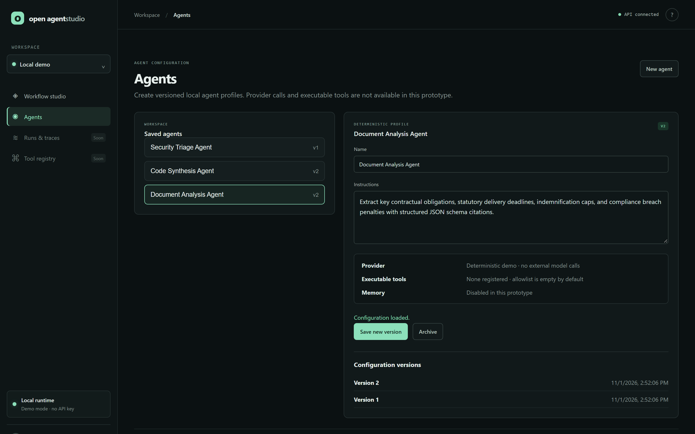
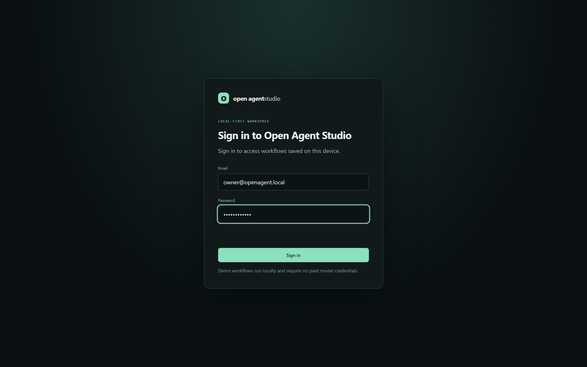

# Open Agent Studio

Open Agent Studio is an open-source, local-first workflow studio prototype. The current demonstrator supports a single local owner, one workspace, saved linear workflows, and deterministic `input → multiply → output` execution with persisted run results. It requires no paid model credentials. **It is not yet the full MVP or suitable for shared/network deployment.**

Repository: https://github.com/0xyz-exe/OpenAgentStudio

## Screenshots

### 1. Studio Canvas & Workflow Builder
Kanvas visual perancangan alur kerja (*workflow builder*) menyediakan antarmuka interaktif berbasis graf node untuk menyusun alur eksekusi deterministik secara modular, menampilkan node Trigger Input, Transform Multiply, dan Output Result yang saling terhubung melalui koneksi kurva mulus, dilengkapi panel konfigurasi parameter alur kerja lokal di sisi kanan serta kontrol penyimpanan dan validasi skema alur.



### 2. Execution Traces & Run Results
Panel pelacakan eksekusi (*execution traces*) menyajikan hasil pemrosesan alur kerja secara terperinci dengan badge status `SUCCEEDED` berkode warna hijau, identifikasi run unik, ringkasan nilai keluaran akhir pada node Result, serta uraian dekomposisi keluaran langkah-demi-langkah per node (*start*, *scale*, dan *finish*) untuk memastikan transparansi dan verifikasi alur kerja lokal tanpa ketergantungan API pihak ketiga.



### 3. Agent Profile Configuration
Antarmuka manajemen profil agen otonom memfasilitasi pembuatan dan pengelolaan agen lokal terversi (*Document Analysis Agent*, *Code Synthesis Agent*, dan *Security Triage Agent*), menyediakan editor instruksi sistem yang fleksibel, pengaturan kapabilitas deterministik terisolasi (tanpa panggilan model eksternal dan allowlist alat kosong secara *default*), serta panel riwayat versi konfigurasi lengkap dengan stempel waktu pembaruan.



### 4. Local Workspace Settings
Gerbang autentikasi dan inisialisasi ruang kerja lokal (*local-first workspace*) mengamankan lingkungan pengujian dan eksekusi pada perangkat pengguna, mewajibkan pembuatan akun pemilik tunggal (*single-owner local account*) yang terproteksi enkripsi kata sandi PBKDF2 berulang, sesi cookie aman bertipe HttpOnly/SameSite, serta verifikasi token CSRF tanpa memerlukan transmisi data ke server eksternal.



## Current status

- **Implemented and tested:** local FastAPI service and responsive static UI; one-time local owner account; PBKDF2 password hashes; opaque server-side sessions; HttpOnly/SameSite cookies and CSRF/origin checks; workspace-scoped SQLite; versioned agent profiles (CRUD/archive) with a deterministic-only provider setting and empty tool allowlist; save/update/select/execute workflows; bounded deterministic `input → multiply → output`; no provider key required.
- **Still missing from P0:** real provider abstraction/adapter, executable tool registry and permissions, approval flow, linking agents to workflow execution, interactive graph editing/branching, durable node-level traces/timing, retries/cancellation, memory/evaluation, multi-user roles/recovery, automated browser E2E, and production hardening.
- **Security:** local only; session cookie is not `Secure` on plain HTTP; do not expose to other devices or the internet. No arbitrary shell, filesystem, or network tools are present.

## Intended MVP

- Create and configure agents and provider-neutral model settings.
- Define and validate deterministic, multi-step workflows.
- Run safe built-in tools with strict schemas and bounded execution.
- Persist executions, node results, traces, and approval decisions.
- Support a no-credential demo mode; no paid provider is required to start.

## Current architecture

- UI: static HTML/CSS/JavaScript served by FastAPI; no build-time frontend dependencies.
- API and deterministic execution: Python 3.11+, FastAPI, Pydantic.
- Persistence: SQLite at `.data/studio.sqlite3` by default; `OPEN_AGENT_STUDIO_DB` can override it. Users, one owner workspace, hashed-token sessions, workflow definitions, and run results are stored locally.
- The current executable is not yet an AI-agent engine: no model provider calls, agent CRUD, tool registry, approvals, retry loop, or advanced graph execution.

Next.js/React and SQLite/PostgreSQL were considered but not adopted in this first prototype. The Next.js install attempt was blocked by the host npm script allowlist; it was not bypassed.

## Documentation

- [Repository audit](docs/REPOSITORY_AUDIT.md)
- [Product requirements](docs/PRD.md)
- [UI/UX brief](docs/UI_UX_BRIEF.md)
- [Architecture](docs/ARCHITECTURE.md)
- [API contract](docs/API.md)
- [Database design](docs/DATABASE_DESIGN.md)
- [Threat model](docs/THREAT_MODEL.md)
- [Security audit](docs/SECURITY_AUDIT.md)
- [Independent engineering review](docs/ENGINEERING_REVIEW.md)
- [Development guide](docs/DEVELOPMENT.md)
- [Deployment status](docs/DEPLOYMENT.md)
- [Implementation report](docs/IMPLEMENTATION_REPORT.md)
- [Test report](docs/TEST_REPORT.md)

## Development

### Windows PowerShell

```powershell
cd $HOME\OpenAgentStudio
py -3 -m venv .venv
.\.venv\Scripts\python.exe -m pip install -e ".[dev]"
.\.venv\Scripts\python.exe -m uvicorn app.main:app --host 127.0.0.1 --port 8000
```

If `py` is unavailable but `python` points to Python 3.11+, use `python -m venv .venv`. Open `http://127.0.0.1:8000`; API docs are at `/docs` and liveness at `/health`.

### Git Bash

```bash
cd /c/Users/wondr/OpenAgentStudio
python -m venv .venv
.venv/Scripts/python -m pip install -e '.[dev]'
.venv/Scripts/python -m uvicorn app.main:app --host 127.0.0.1 --port 8000
```

Run tests: `.venv/Scripts/python -m pytest -q`. Verify JavaScript with `node --check app/static/studio.js`. The SQLite store is created automatically in `.data/studio.sqlite3`; `.env.example` is reference-only and is not loaded automatically. The deterministic demo needs no model account or provider secret. Browser E2E, live provider calls, and shared deployment have not been verified.

Node/npm were detected, but Next.js scaffold installation was blocked by the host npm `allow-scripts` policy. To avoid bypassing it, the partial scaffold was removed; the current static UI requires no npm. Docker Compose is not configured.

## Security

Authentication and CSRF/origin controls protect the current single-owner local API, but the service is not production-ready. Keep Uvicorn bound to `127.0.0.1`; the session cookie is non-Secure for local plain HTTP. There is no multi-user role management, login rate limiting, password recovery, model credential storage, or shared-deployment hardening. See `docs/SECURITY_AUDIT.md`.

## License

Licensed under MIT; see [LICENSE](LICENSE). Contributions are welcome under [CONTRIBUTING.md](CONTRIBUTING.md).
