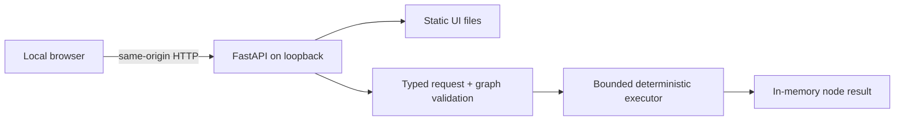
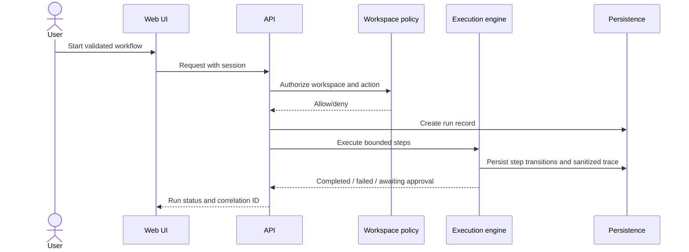

# Architecture (proposed)

**Status:** the first local demo is implemented; broader architecture below remains a proposal. See README and implementation report for actual shipped scope.

## Principles

Separate UI, transport/API, domain validation/execution, persistence, provider adapters, and tool implementations. Keep execution deterministic and bounded; keep external I/O outside database transactions; version workflow definitions; authorize every protected operation server-side. Prefer a modular monolith over microservices until measured requirements justify distribution.

## Proposed topology

This small topology describes the currently implemented local demo. Authentication, database, model provider and rich tool adapters shown in the product proposal do not exist yet.

## Request/execution sequence

## Module boundaries

- **Web:** presentation, forms, accessibility, trace visualization; never holds provider credentials or enforces authorization alone.
- **API:** request parsing, schema validation, authentication, authorization, stable errors, rate/resource limits.
- **Domain:** agent configuration, graph validation, state machine, approval policy; independent of HTTP framework.
- **Execution:** bounded sequential traversal, timeout/cancellation policy, idempotency and retry eligibility.
- **Tools:** explicit registry, strict schemas, allowlists, timeout/output cap; no arbitrary shell or unrestricted network/filesystem.
- **Providers:** replaceable interface with timeout/retry/error mapping; explicit configuration; deterministic demo does not masquerade as a live model.
- **Persistence:** transaction-scoped repositories, migrations, workspace-scoped access. SQLite proposed for local use; PostgreSQL support not promised until verified.

## Execution state proposal

Run: `queued -> running -> awaiting_approval -> running -> succeeded | failed | cancelled`; terminal states cannot transition again. Node transitions are persisted independently and retries are limited to explicitly eligible, side-effect-safe failures. Approval decisions are unique and expiry-aware. This model requires implementation and tests before being considered enforced.

## Decisions and open questions

- Proposed UI: Next.js/React/TypeScript; API: FastAPI/Pydantic.
- Proposed local database: SQLite; evaluate ORM/migrations and async compatibility before adding dependencies.
- Select graph editor only after checking active maintenance and compatibility with chosen React version.
- Keep background queue out of initial architecture; revisit after execution durability/concurrency needs are measurable.
- Confirm supported Node/Python versions from framework metadata before pinning.
